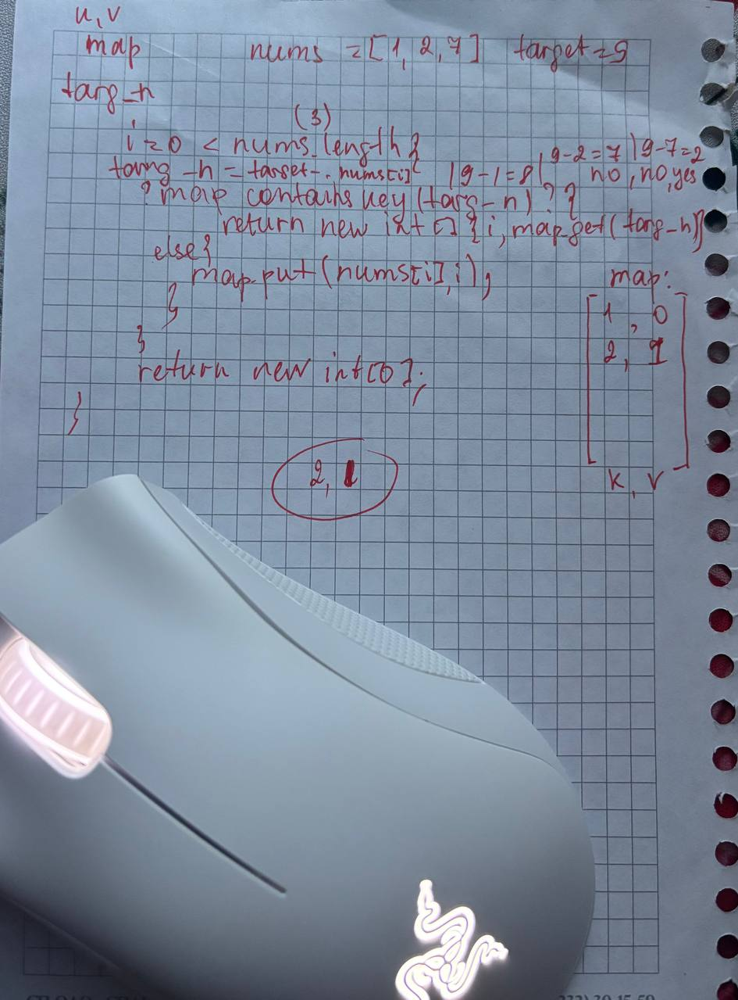

<div align="center">

# Two Sum

### ⚡ A lightning-fast solution to the most classic LeetCode problem


*Solving the most common LeetCode problem — the right way.*

</div>

---

## 📖 About

This project walks you through solving **Two Sum**, one of the most frequently asked coding interview problems.

## 🧠 The Problem

Given an array of integers `nums` and an integer `target`, return the indices of the two numbers that add up to `target`.

**Example:**
```text
Input:  nums = [2, 7, 11, 15], target = 18
Output: [2, 1]
```

## 🤓 
